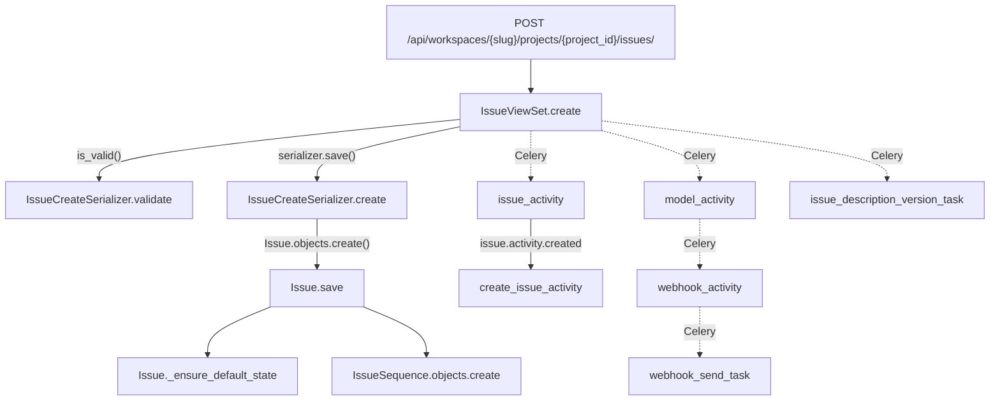
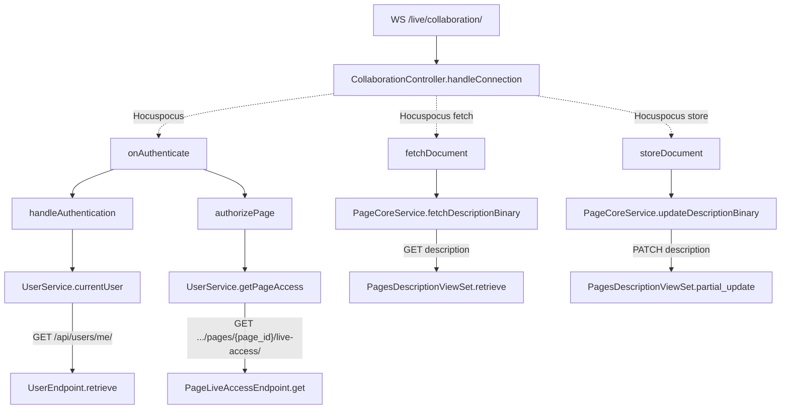

# Endpoint và luồng gọi backend Plane Demo

[Mở sơ đồ tương tác](./plane-demo-backend.html) để tra theo URL, tên controller, function hoặc file. Mỗi endpoint có cây lời gọi, độ sâu từ 1 đến 5 và vị trí trong source. Chọn một function để xem các function mà nó gọi và các nơi gọi đến nó. Nút **Tải CSV** xuất danh sách đang lọc.

Khảo sát checkout `cortex-town/plane-demo` tại commit `da21a8ff8b`. Phạm vi gồm Django trong `apps/api/plane`, các lệnh Python đi kèm và dịch vụ Live TypeScript trong `apps/live/src`.

## Thống kê

| Nhóm endpoint                       |  Số mục |
| ----------------------------------- | ------: |
| Django app `/api/`                  |     442 |
| API v1 `/api/v1/`                   |     176 |
| Public `/api/public/`               |      42 |
| Xác thực `/auth/`                   |      37 |
| Quản trị instance `/api/instances/` |      21 |
| OpenAPI tùy cấu hình `/api/schema/` |       3 |
| Web và handler 404                  |       3 |
| Live HTTP và WebSocket `/live/`     |       4 |
| **Tổng**                            | **728** |

- **397 mẫu đường dẫn**, tính cả đường dẫn có format suffix và mục handler 404. Mỗi HTTP method có một mục tra cứu. `HEAD` và `OPTIONS` tự sinh từ framework được lược khỏi thống kê.
- **2.290 function, method và callback được khai báo**. Django có 1.873 trong mã runtime, 67 trong migration và 44 trong CLI/seed. Live có 306.
- **1.264 function khai báo** nối được từ endpoint hoặc hook request. Danh mục có thêm 58 handler kế thừa được biểu diễn như nút logic để nối đến các override của Plane. 5 mục route do thư viện cung cấp.
- **4.288 cạnh, 3.687 cặp gọi → được gọi**. Một cặp có thể xuất hiện tại nhiều dòng hoặc qua nhiều cơ chế, chẳng hạn gọi thường và đưa vào hàng đợi.

## Ví dụ 1. Tạo issue

[Mở luồng POST tạo issue](./plane-demo-backend.html#r482)

Luồng đi từ controller qua kiểm tra dữ liệu và ghi issue. Lịch sử hoạt động, webhook và phiên bản mô tả được lên lịch từ controller. [Controller issue](../../cortex-town/plane-demo/apps/api/plane/app/views/issue/base.py#L406) · [Model issue](../../cortex-town/plane-demo/apps/api/plane/db/models/issue.py#L180)

## Ví dụ 2. Mở kết nối cộng tác

[Mở luồng WebSocket](./plane-demo-backend.html#r723)

Live gọi Django qua HTTP để kiểm tra người dùng, quyền mở trang và đọc hoặc ghi nội dung. Graph cũng nối chiều ngược lại khi tác vụ sao chép asset gọi `POST /live/convert-document/`. [Xác thực Live](../../cortex-town/plane-demo/apps/live/src/lib/auth.ts#L27) · [Endpoint kiểm tra quyền trang](../../cortex-town/plane-demo/apps/api/plane/app/views/page/live.py#L30) · [Luồng sao chép trang](./plane-demo-backend.html#r570)

## Phạm vi của đồ thị

- Route Django lấy từ URL resolver của `settings.common`, bật OpenAPI để ghi cả route tùy cấu hình. Route Live lấy từ decorator của controller với tiền tố mặc định `/live`, có thể đổi bằng môi trường.
- Đồ thị được dựng bằng phân tích tĩnh AST Python và symbol TypeScript. Lời gọi trực tiếp, callback, hook serializer/ORM, signal, Celery và HTTP liên dịch vụ có nhãn riêng. Một cạnh theo điều kiện chỉ biểu thị nhánh có thể chạy.
- Biểu thức gọi qua thư viện, package dùng chung ngoài hai app hoặc đích động chưa phân giải xuất hiện dưới từng function. Danh mục giữ cả function chưa xác định được đường từ endpoint, trong đó có migration, lệnh quản trị, startup và tác vụ định kỳ. Test, mã frontend và cấu hình Caddy nằm ngoài phạm vi.
