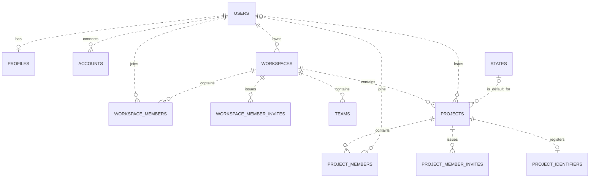
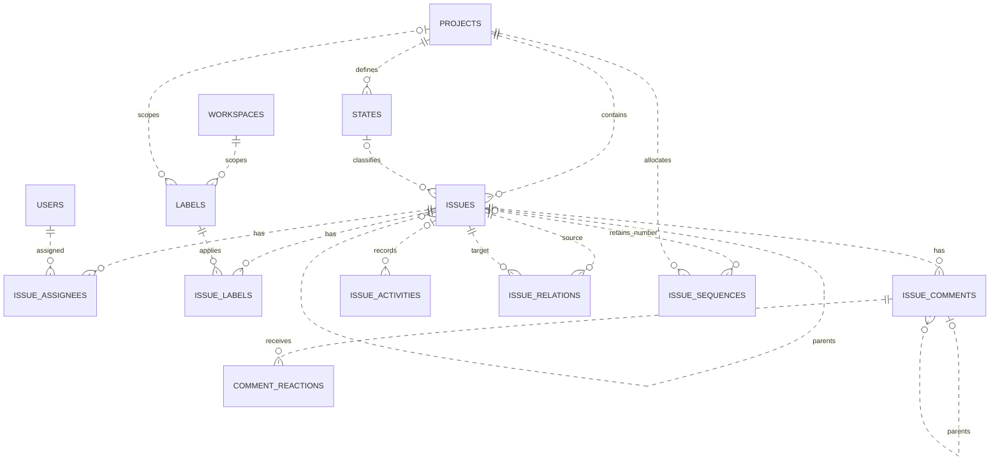
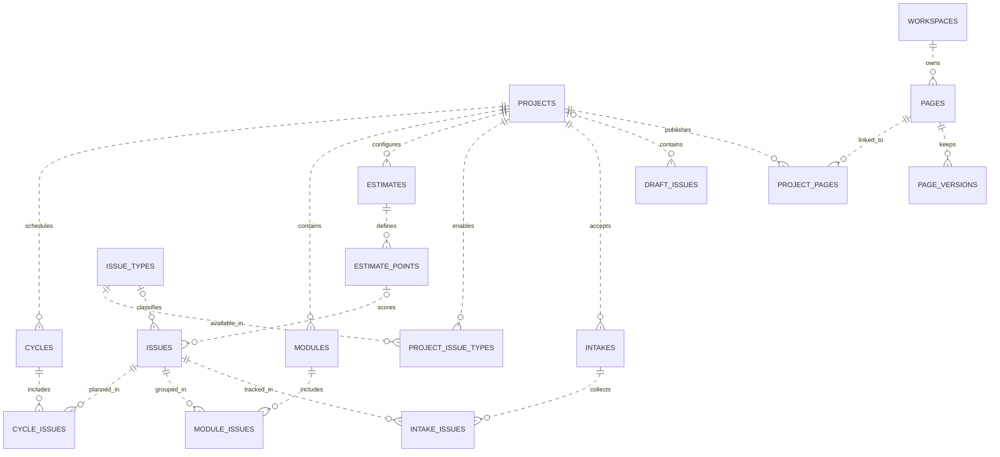

# Cấu trúc database Plane Demo

Phần ERD mô tả Plane Demo. Phần cuối ghi phương án chuyển sang Drizzle và Cloudflare D1 cùng phạm vi migration Lancity.

- Nguồn là checkout `cortex-town/plane-demo` tại commit `da21a8ff8b` ngày 20/11/2026. Backend dùng Django và PostgreSQL. Các migration ứng dụng kết thúc ở `db.0125_reset_project_deploy_board_identity` và `license.0006_instance_is_current_version_deprecated`. Tất cả migration đã được chạy trên một PostgreSQL 17 tạm để đối chiếu cấu trúc.
- Phạm vi gồm **110 bảng**. Trong đó có 92 bảng nghiệp vụ Plane, 4 bảng quản trị instance và 14 bảng hạ tầng Django/Celery, bao gồm cả bảng sổ migration.
- [Từ điển dữ liệu đầy đủ](./plane-demo-data-dictionary.md) liệt kê từng cột, kiểu PostgreSQL, khả năng nhận NULL, khóa chính, khóa ngoại, ràng buộc và chỉ mục.

## 1. Người dùng, workspace và project

- `users` giữ danh tính. `profiles` giữ hồ sơ và tùy chọn cá nhân. `accounts` lưu tài khoản từ nhà cung cấp đăng nhập. `sessions` của Plane giữ phiên riêng với `django_session`.
- `workspace_members` và `project_members` lưu vai trò theo từng phạm vi. Lời mời nằm ở hai bảng riêng. Thành viên công khai đi qua `project_public_members`.
- Tên và mã project có unique index trong workspace đối với bản ghi chưa xóa mềm. `project_identifiers` đăng ký mã theo workspace.

## 2. Issue và cộng tác

- Plane gọi công việc là **issue**. Issue liên kết trạng thái, issue cha, người phụ trách, nhãn, người theo dõi, lượt reaction, phiếu bầu, liên kết và đính kèm.
- `issue_relations` và `issue_blockers` là hai bảng riêng. `issue_versions` lưu ảnh chụp dữ liệu issue, còn `issue_description_versions` lưu phiên bản nội dung mô tả.
- `issues.id` là khóa chính UUID trong Plane. `sequence_id` là số hiển thị trong project. Plane cấp số qua `issue_sequences` và khóa giao dịch PostgreSQL theo project.
- Nhãn có thể thuộc riêng một project hoặc dùng ở cấp workspace. Trong migration hiện tại, unique index dành cho nhãn có `project_id IS NULL` đặt trên `name`, nên tên nhãn dạng này được kiểm tra duy nhất trên toàn bảng.

## 3. Lập kế hoạch, intake và tài liệu

- Cycle và module liên kết nhiều–nhiều với issue. Mỗi nhóm có bảng tùy chọn hiển thị riêng. Module còn có bảng thành viên và liên kết.
- Intake giữ hàng chờ cho issue được gửi vào. Issue nháp có bảng riêng cho người phụ trách, nhãn, cycle và module.
- Page thuộc workspace và có thể gắn với nhiều project. Page có cây cha–con, nhãn, log chỉnh sửa và lịch sử phiên bản. `descriptions` và `description_versions` giữ nội dung và lịch sử mô tả.

## 4. Danh mục bảng theo nhóm

| Nhóm                                                                                 | Số bảng | Dữ liệu chính                                                               |
| ------------------------------------------------------------------------------------ | ------: | --------------------------------------------------------------------------- |
| [Danh tính và thiết bị](./plane-demo-data-dictionary.md#danh-tinh-va-thiet-bi)       |       7 | Người dùng, hồ sơ, tài khoản liên kết, phiên, thiết bị và kết nối đăng nhập |
| [Workspace và project](./plane-demo-data-dictionary.md#workspace-va-project)         |      14 | Phạm vi tổ chức, vai trò, lời mời, mã project và tùy chọn theo người dùng   |
| [Issue và cộng tác](./plane-demo-data-dictionary.md#issue-va-cong-tac)               |      19 | Issue, trạng thái, nhãn, quan hệ, lịch sử, bình luận và phản hồi            |
| [Lập kế hoạch và intake](./plane-demo-data-dictionary.md#lap-ke-hoach-va-intake)     |      19 | Cycle, module, estimate, loại issue, intake và bản nháp                     |
| [Tài liệu, tệp và chia sẻ](./plane-demo-data-dictionary.md#tai-lieu-tep-va-chia-se)  |      11 | Page, mô tả, phiên bản, asset và trang công khai                            |
| [Tùy chọn và thông báo](./plane-demo-data-dictionary.md#tuy-chon-va-thong-bao)       |       8 | View đã lưu, yêu thích, truy cập gần đây, ghi chú và thông báo              |
| [Tích hợp và nhập xuất](./plane-demo-data-dictionary.md#tich-hop-va-nhap-xuat)       |      14 | GitHub, Slack, webhook, API token, nhật ký và lịch sử nhập xuất             |
| [Quản trị instance](./plane-demo-data-dictionary.md#quan-tri-instance)               |       4 | Instance, quản trị viên, cấu hình và changelog                              |
| [Hạ tầng Django và Celery](./plane-demo-data-dictionary.md#ha-tang-django-va-celery) |      14 | Nhóm quyền, content type, session Django, sổ migration và lịch tác vụ       |
| **Tổng**                                                                             | **110** |                                                                             |

## 5. Phương án Lancity trên Drizzle và D1

Migration `0001_plane_domain.sql` bổ sung 93 bảng nghiệp vụ và quản trị từ Plane, cùng `project_issue_counters` để lưu số issue gần nhất theo project. Ba bảng danh tính của Plane ánh xạ vào Better Auth hiện có. 14 bảng nội bộ của Django/Celery được giữ trong tài liệu nguồn. Tổng cộng Lancity có 98 bảng ứng dụng, gồm bốn bảng Better Auth.

| Phần                      | Đề xuất để duyệt                                                                                                                                                                                                                                         |
| ------------------------- | -------------------------------------------------------------------------------------------------------------------------------------------------------------------------------------------------------------------------------------------------------- |
| Danh tính                 | Dùng `user`, `account`, `session` và `verification` của Better Auth hiện có. FK người dùng trong bảng nghiệp vụ trỏ về `user.id`. Giữ hồ sơ ứng dụng trong bảng riêng với `user_id` duy nhất.                                                            |
| Khóa chính                | Dùng `INTEGER PRIMARY KEY AUTOINCREMENT` cho các bảng mới, kể cả bảng nối. Giữ số issue theo project tách khỏi PK. Nếu nhập dữ liệu nguồn, cần bảng ánh xạ UUID sang ID số hoặc cột lưu ID cũ tùy yêu cầu đồng bộ. ID từ dịch vụ bên ngoài giữ kiểu gốc. |
| Kiểu cột                  | Chuyển PostgreSQL `jsonb` và snapshot dạng mảng sang JSON trong cột `TEXT`, dữ liệu nhị phân sang `BLOB`, timestamp sang mili giây UTC trong `INTEGER` và ngày thuần sang `TEXT` theo `YYYY-MM-DD`.                                                      |
| Phạm vi dữ liệu           | Ràng buộc issue, state, cycle và các bảng nối phải thống nhất workspace/project. Khi bảng con giữ cả hai ID, có thể dùng FK ghép tới khóa duy nhất tương ứng hoặc dẫn xuất workspace từ project để tránh lệch phạm vi.                                   |
| Xóa mềm và audit          | Giữ `created_at`, `updated_at`, `deleted_at` và các FK audit khi cần. Dùng unique index có điều kiện `WHERE deleted_at IS NULL` cho tên, mã và bảng nối vốn có quy tắc đó. Chốt chính sách tên nhãn cấp workspace trước khi tạo index.                   |
| Cấp số issue              | Thay PostgreSQL advisory lock bằng bộ đếm theo project và ghi issue trong cùng thao tác nguyên tử của D1. Đề xuất khóa duy nhất `(project_id, sequence_id)` và kiểm thử tạo đồng thời.                                                                   |
| Tệp và tham chiếu đa loại | D1 giữ metadata và khóa đối tượng. Đề xuất R2 cho tệp tải lên. Với cặp loại/ID có thể trỏ nhiều bảng, cần quy định kiểu ID và nơi xác thực đối tượng đích.                                                                                               |
| Hạ tầng                   | Giữ bảng tích hợp, nhật ký và cấu hình instance theo nhu cầu tính năng được duyệt. Quyền workspace/project tham chiếu bảng thành viên. Lịch tác vụ có thể dùng Worker Cron/Queues.                                                                       |

Các điểm cần chốt trước khi sinh migration là phạm vi tính năng đợt đầu, có nhập dữ liệu Plane hay không, và quy tắc duy nhất của nhãn cấp workspace. Tham chiếu kỹ thuật về kiểu dữ liệu và ràng buộc D1. [Câu lệnh SQL và PRAGMA của D1](https://developers.cloudflare.com/d1/sql-api/sql-statements/) · [Khóa ngoại trong D1](https://developers.cloudflare.com/d1/sql-api/foreign-keys/)
